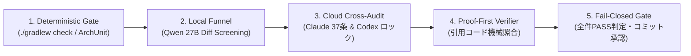

# プロジェクトエージェント運用規定およびハイブリッドAI検証パイプライン規約

## 0. 基本原則およびコミュニケーション規約
1. **指示受領およびロードマップの事前提示**:
   - 変更・リファクタリング・検証に着手する際は、作業目的（What & Why）および段階的な実行ロードマップ（Step 1, Step 2...）を事前に明示して着手する。
2. **フォーマットおよび表記保護**:
   - 時間範囲や数値範囲の表記にはバッククォート（例: `18:00 ~ 23:00`）またはエスケープを使用し、取り消し線の誤発生を防止する。
3. **ローカル監査モデルのスペック**:
   - メインモデル: `qwen3.8:27b`（自社リモートGPU加速環境）
   - 最上位規約: `GEMINI.md` が最上位SSOTであり、本規約はその施行細則として機能する。

---

## 1. 統一5層ハイブリッド検証パイプライン（Unified 5-Tier Verification Pipeline）
本プロジェクトは単一障害点および特定モデルへの依存を排除し、決定論的静的解析と多重AIによる厳格なFail-Closedパイプラインを運用する:

1. **Stage 1: 決定論的ゲート（`./gradlew check`）**:
   - 費用0円の高速Fail-Fastゲート。
   - コンパイル検証、JUnit 5単体/統合テスト、ArchUnit（給与・サービス層の浮動小数点型禁止、レイヤ分離規則）、MyBatis SQLインジェクション静的検知（`${}`禁止）、Zero-Korean検証を包括実行。
2. **Stage 2: ローカルファネルスクリーニング（Local Qwen 27B）**:
   - `git diff` 変更ファイルおよび関連サービスクラスのSHA-256スナップショットを取得。
   - 無料の自社GPUを用いて危険個所・不変条件違反の一次スクリーニングを実施し、クラウドAIへの送信コンテキストを最適化。
3. **Stage 3: クラウドAIクロス監査（Claude & Codex）**:
   - **Claude**: 日本労働基準法第37条（時間外25%、深夜25%、深夜残業重複50%、法定休日35%、休日深夜60%）の計算整合性・例外分岐の推論監査。
   - **Codex**: Spring Boot 4 / MyBatisアーキテクチャ、悲観的ロック（`SELECT ... FOR UPDATE`）の同時実行制御、IDOR（テナント分離）検証。
4. **Stage 4: 実証引用検証（Proof-First Citation Verifier）**:
   - AI監査レポート内の引用 `[相対パス:行番号]` が実際の `.java`/`.xml`/`.sql` コードと完全に一致するかを機械検証。
   - 存在しないコード行の幻覚（Hallucination）引用および監査中のコンテキスト変更（Stale Context）を検知した場合は即時却下。
5. **Stage 5: Fail-Closed判定および監査台帳保存**:
   - 未解決のP0/P1重大欠陥が存在する場合、ビルドを非ゼロ終了コードで遮断（Fail-Closed）。
   - 全検証ログを `audit/runs/` 配下に領収書として永続化。

---

## 2. 5段階検証プロセス（Standard Operating Procedure）

- **[コミット前ハードゲート]**: 上記の決定論的ゲートおよび多層AI監査がすべてPASSとなるまで、Gitコミットの提案は厳格に保留される。

---

## 3. デイリースプリント増分ロードマップ（10-Day Plan） ★docs/sprint_roadmap_plan.md 連動

| 日次 (Day) | 状態 | 対象ブランチ / ドメイン | 実装およびリファクタリング内容 |
|:---:|:---:|---|---|
| **Day 1** | **完了** | `main`（ベースライン） | 労働基準法第37条計算エンジン統合、5層ハイブリッド検証環境およびArchUnitゲート構築 |
| **Day 2** | 待機 | `feature/auth-security` | Spring Security 6 セッション認証、RBAC権限分離、IDOR防御 |
| **Day 3** | 待機 | `feature/attendance-punch` | 4打刻ステートマシン、非同期UI連携、ゴースト打刻締め処理 |
| **Day 4** | 待機 | `feature/shift-request` | FullCalendar連携 希望勤務シフト申請、最大16時間拘束バリデーション |
| **Day 5** | 待機 | `feature/shift-confirm` | 店舗管理者シフト確定トランザクション、**悲観的ロック（`SELECT ... FOR UPDATE`）** 同時実行制御 |
| **Day 6** | 待機 | `feature/labor-calc-engine` | **日本労働基準法第37条 6段階法定割増精密計算エンジン** |
| **Day 7** | 待機 | `feature/payroll-batch` | 月次給与自動集計バッチ、未処理勤怠ガード、1円単位端数処理（`HALF_UP`） |
| **Day 8** | 待機 | `feature/payroll-excel` | Apache POI 5.2基盤 公式給与台帳Excelダウンロード |
| **Day 9** | 待機 | `feature/mod-workflow` | 勤怠修正申請および管理者承認/却下決裁ワークフロー、監査証跡 |
| **Day 10** | 待機 | `docs/final-dossier` | 多層AI全数クロス監査、Zero-Korean完全検証、最終ポートフォリオ整備 |
