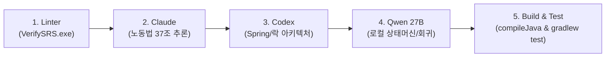

# Project Agents & Collaborative Audit Workflow (Hermes Pipeline)

## 0. 커뮤니케이션 및 서식 절대 원칙 (Acknowledge & Format Rules) ★필수
1. **[필수 선(先) 복명복창 및 단계별 작업 계획 선행 브리핑]**: 사용자가 어떤 명령이나 작업(수정, 업데이트, 검수, 신규 생성, 리팩토링 등)을 내렸을 때, 혼자 도구부터 실행하지 않고 **반드시 첫 문장으로 사용자가 시킨 내용을 자연스럽게 복명복창(Acknowledge & Reiterate)**한다. 그 다음 **이번 작업에서 구현/수정할 기능의 비즈니스 목적(What & Why)과 단계별 실행 로드맵(Step 1, Step 2, Step 3...)을 먼저 명확하게 설명**한 뒤 순서대로 업무에 착수한다. 사용자가 어떤 기능을 어떻게 만드는지 사전에 투명하게 이해할 수 있도록 하는 것이 핵심이다.
   - 예시 규격:
     > *"사용자님께서 말씀하신 **[OO 기능에 관한 OO 작업]** 요청 확인했습니다! 사용자님께서 내리신 명령을 성실히 수행하겠습니다.*
     > *이번 작업은 [기능의 필요성/목적]을 위해 진행되며, 아래와 같은 단계로 나누어 순차적으로 진행하겠습니다:*
     > *- Step 1: [어떤 파일에서 어떤 로직 구현]*
     > *- Step 2: [보안/예외 처리 및 연동]*
     > *- Step 3: [로컬 Hermes 감사 및 컴파일 빌드 검증]*
     > *그럼 1단계부터 착수하겠습니다."*
   - 단, `[지시 접수 및 복명복창]` 같은 딱딱한 기계적 태그나 머리말은 일체 붙이지 않는다.
2. **[경례 이모지(🫡) 엄격 금지]**: 사용자가 조롱 또는 기계적 태도로 느끼므로 일체 사용을 엄격히 금지한다.
3. **[마크다운 물결표(~) 취소선 방지 서식]**:
   - 마크다운 파서가 물결표를 취소선(`~~취소선~~`)으로 오작동시키는 것을 방지하기 위해, 시간이나 기간 등 범위를 표기할 때는 반드시 백틱(예: `` `18:00 ~ 23:00` ``)으로 감싸거나 앞뒤 공백 및 역슬래시(`\~`)를 사용하여 본문에 가로줄(취소선)이 절대 생기지 않도록 한다.
4. **[로컬 감사 모델 명칭 및 스펙 절대 준수]**:
   - 메인 감사 모델: **`qwen3.8:27b`** (`qwen27b:latest`, 자택 데스크톱 NVIDIA GeForce RTX 5070 Ti, Tailscale 원격 가속)
   - 비상 폴백: `qwen2.5:7b` (노트북 RTX 3060, Ollama 로컬)
   - 최상위 헌법 위계: **`GEMINI.md`가 최상위 헌법(SSOT)이며, 본 문서는 세부 실행 규정으로 종속**된다.

---

## 1. Unified 5-Tier Verification Pipeline (GEMINI.md 제1조 準拠)
본 프로젝트는 특정 모델 의존과 단일 장애점을 배제하고, `GEMINI.md` 제1조에 따라 **결정론적 린터 + 다층 AI 5중 교차 검증 파이프라인**을 절대적 Fail-Closed 원칙으로 운영한다:

1. **Stage 1: Deterministic Linter Gate (`specs/VerifySRS.exe` / `tools/scripts/verify_srs.ps1`)**:
   - 비용 0원, 0.1초 컷오프 기계적 구문/SSOT 린터 게이트.
   - 설계 SSOT(`specs/srs_specification_ssot.md`) 및 요구사항 ID 규격, DoD 무결성을 사전 검증.
2. **Stage 2: Anthropic Claude (`tools/scripts/call_claude.ps1`, Sonnet 3.5)**:
   - 일본 노동기준법 제37조(야간 25%, 연장 25%, 중복 50%, 법정휴일 35%, 휴일심야 60%) 및 예외 분기 심층 추론 감사.
3. **Stage 3: OpenAI Codex (`tools/scripts/call_codex.ps1`, codex.exe)**:
   - Spring Boot 4 / MyBatis 아키텍처, DDL 스키마 정합성, 비관적 락(`SELECT ... FOR UPDATE`) 동시성 제어 교차 감사.
4. **Stage 4: Local Qwen 27B (`call_qwen.ps1` / `audit_with_hermes.ps1`, RTX 5070 Ti)**:
   - 4타각 상태 머신 전이 불변성, 회귀 결함 검수 및 대화 보고 시 Execution Metrics 한글 표 실측치 보고.
5. **Stage 5: Antigravity (Lead Developer & Master Orchestrator)**:
   - 소스 코드 리팩토링, 결함 자가 보완, 빌드/단위테스트 검증, 원격 푸시 대상 파일 Zero-Korean 하드게이트(코드·주석·문서 100% 일본어/영문, 사용자 대화 제외) 통과 후 사용자에게 최종 보고.
6. **User (Final Approver)**:
   - 5중 파이프라인의 전수 합격(PASS) 결과를 확인한 후, 최종 Git 커밋/푸시 승인.

---

## 2. 공식 5단계 무결성 검증 프로세스 (Daily Standard Operating Procedure)

모든 코드 수정 후 커밋 직전에는 **반드시 아래 5단계 하드게이트를 순차적으로 전수 통과**해야 한다:

- **[하드게이트 철칙]**: 위 5개 단계 중 단 1개라도 누락되거나 미실행된 상태에서 사용자에게 커밋을 제안하는 행위를 엄격히 금지한다.

---

## 3. Daily 1-Sprint Incremental Roadmap (10-Day Plan) ★docs/sprint_roadmap_plan.md 연동

| 일차 (Day) | 상태 | 대상 브랜치 / 도메인 | 핵심 구현 및 리팩토링 내용 |
|:---:|:---:|---|---|
| **Day 1** | **진행 중** | `main` (베이스라인) | 프로젝트 2 패치 통합, 労基法 37조 중복계상 해소, 5중 다층 검수 완료 |
| **Day 2** | 대기 | `feature/auth-security` | Spring Security 6 세션 인증, RBAC 권한 분리, IDOR 보안 방어 |
| **Day 3** | 대기 | `feature/attendance-punch` | 4타각 상태머신, 비동기(Fetch) UI 연동, 고스트 타각 마감 데드락 해소 |
| **Day 4** | 대기 | `feature/shift-request` | FullCalendar 연동 희망 근무 일정 신청, 최대 16시간 구속 검증 |
| **Day 5** | 대기 | `feature/shift-confirm` | 점주 시프트 확정 트랜잭션, **비관적 락(`SELECT ... FOR UPDATE`)** 동시성 제어 |
| **Day 6** | 대기 | `feature/labor-calc-engine` | **일본 노동기준법 제37조 6단계 법정 할증 정밀 계산 엔진** |
| **Day 7** | 대기 | `feature/payroll-batch` | 월간 급여 자동 집계, 미처리 근태 가드, 1엔 단위 반올림(`HALF_UP`) |
| **Day 8** | 대기 | `feature/payroll-excel` | Apache POI 5.2 기반 공식 급여대장 Excel 다운로드 |
| **Day 9** | 대기 | `feature/mod-workflow` | 근태 수정 신청 및 점주 승인/반려 결재 워크플로우, 감사 증적 |
| **Day 10** | 대기 | `docs/final-dossier` | 다층 AI 전수 교차 검수, Zero-Korean 완전 감사, 최종 포트폴리오 정비 |
