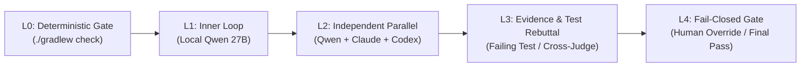

# プロジェクトエージェント運用規定およびハイブリッドAI検証パイプライン規約

## 0. 基本原則およびコミュニケーション規約
1. **指示受領およびロードマップの事前提示**:
   - 変更・リファクタリング・検証に着手する際は、作業目的（What & Why）および段階的な実行ロードマップ（Step 1, Step 2...）を事前に明示して着手する。
2. **フォーマットおよび表記保護**:
   - 時間範囲や数値範囲の表記にはバッククォート（例: `18:00 ~ 23:00`）またはエスケープを使用し、取り消し線の誤発生を防止する。
3. **ローカル監査モデルのスペック**:
   - メインモデル: `qwen3.8:27b`（自社リモートGPU加速環境）
   - 最上位規約: `GEMINI.md` が最上位SSOTであり、本規約はその施行細則として機能する。

---

## 1. 統一多層ハイブリッド検証アーキテクチャ（2-Track Verification Architecture）
本プロジェクトは単一障害点および特定モデルへの依存を排除し、決定論的静的解析と多重AIによる厳格なFail-Closedパイプラインを運用する:

- **L0: 決定論的ゲート（`./gradlew check`）**:
  - 費用0円の高速Fail-Fastゲート。
  - コンパイル検証、JUnit 5単体/統合テスト、ArchUnit（給与・サービス層の浮動小数点型禁止、レイヤ分離規則）、MyBatis SQLインジェクション静的検知（`${}`禁止）、Zero-Korean検証を包括実行。
- **L1: 日常インナーループ（ローカル Qwen 27B 単独・規則別狭小プロンプト）**:
  - コスト0円。開発作業中の即時フィードバック専用（アドバイザリ）。
  - IDOR有無、ロック獲得順序、37条端数処理など、単一ルールに特化した狭小プロンプトで高速反復スキャン。
- **L2: マスタアウターゲート3者完全並行（Start-Job Fan-out: Qwen 27B + Claude Sonnet 5.5 + OpenAI Codex）**:
  - スプリント締め時または検証時にdiff全域を3者完全並行で同時起動（所要時間を従来の約2分30秒から約30〜60秒へ短縮）。
  - 各モデルは独立して `git diff` を検証し、全Findingを構造化JSON `[ファイル:行, 主張, 失敗シナリオ(入力値→不正結果)]` で出力。
- **L3: 実証引用・相互反証および失敗テスト機械再現（Proof-First & Cross-Rebuttal）**:
  - 最優先証拠: 指摘された失敗シナリオを失敗するJUnit 5テストに変換し `./gradlew check` で機械再現。再現されない空論は即時却下。
  - 相互反証: Claudeの指摘はCodexがコードに基づき反証を試み、Codexの指摘はClaudeが反証を試みる。反証不能な指摘のみ真の欠陥と判定し、見解不一致時のみ人間にエスカレーション。
- **L4: Fail-Closed判定および監査台帳保存**:
  - 未解決のP0/P1重大欠陥が存在する場合、ビルドを非ゼロ終了コードで遮断（Fail-Closed）。
  - 全検証ログを `audit/runs/` 配下に領収書として永続化。

---

## 2. 5段階検証プロセスおよび高リスクルーティング

- **[高リスクドメインルーティング]**: 以下の対象を含むdiffは必ずL2・L3監査へ自動昇格する：
  1. 労務計算および勤怠・シフトコアService (`*Service.java`, `*Calculator.java`)
  2. MyBatis マッパーXML (`*Mapper.xml`)
  3. DDLおよびマイグレーションSQL (`*.sql`)
  4. Spring Security 設定および認可ハンドラー (`SecurityConfig.java` 等)
  5. アプリケーション設定ファイル (`application*.yml`, `application*.properties`)
- **[コミット前ハードゲート]**: 上記の決定論的ゲートおよび多層AI監査がすべてPASSとなるまで、Gitコミットの提案は厳格に保留される。
- **[日次スプリント1-Shot完全同期原則]**: マスタコミット直前には必ず以下の5大成果物を単一バッチ（1-Shot）で漏れなく同期する：
  1. `docs/technical_audit_dossier.md`（日本語正本実証書：版数・是正台帳・実測値）
  2. `docs/technical_audit_dossier_KO.md`（韓国語対照本実証書：1:1対照反映）
  3. `docs/sprint_roadmap_plan.md` および `AGENTS.md`（日本語正本ロードマップ：完了ステータス更新）
  4. `docs/sprint_roadmap_plan_KO.md`（韓国語対照本ロードマップ：完了ステータス更新）
  5. `audit/runs/` 配下の物理領収書内のローカルパス除染および `docs/daily_audit_temp.log` 整理

---

## 3. デイリースプリント増分ロードマップ（10-Day Plan） ★docs/sprint_roadmap_plan.md 連動

| 日次 (Day) | 状態 | 対象ブランチ / ドメイン | 実装およびリファクタリング内容 |
|:---:|:---:|---|---|
| **Day 1** | **完了** | `main`（ベースライン） | 労働基準法第37条計算エンジン統合、5層ハイブリッド検証環境およびArchUnitゲート構築 |
| **Day 2** | **完了** | `feature/auth-security` | Spring Security 6 セッション認証、RBAC権限分離、IDOR防御、9大欠陥全数是正 |
| **Day 3** | 待機 | `feature/attendance-punch` | 4打刻ステートマシン、非同期UI連携、ゴースト打刻締め処理 |
| **Day 4** | 待機 | `feature/shift-request` | FullCalendar連携 希望勤務シフト申請、最大16時間拘束バリデーション |
| **Day 5** | 待機 | `feature/shift-confirm` | 店舗管理者シフト確定トランザクション、**悲観的ロック（`SELECT ... FOR UPDATE`）** 同時実行制御 |
| **Day 6** | 待機 | `feature/labor-calc-engine` | **日本労働基準法第37条 6段階法定割増精密計算エンジン** |
| **Day 7** | 待機 | `feature/payroll-batch` | 月次給与自動集計バッチ、未処理勤怠ガード、1円単位端数処理（`HALF_UP`） |
| **Day 8** | 待機 | `feature/payroll-excel` | Apache POI 5.2基盤 公式給与台帳Excelダウンロード |
| **Day 9** | 待機 | `feature/mod-workflow` | 勤怠修正申請および管理者承認/却下決裁ワークフロー、監査証跡 |
| **Day 10** | 待機 | `docs/final-dossier` | 多層AI全数クロス監査、Zero-Korean完全検証、最終ポートフォリオ整備 |
