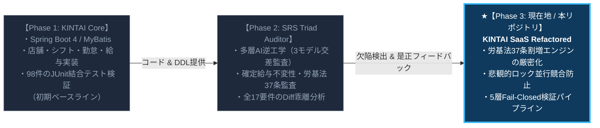
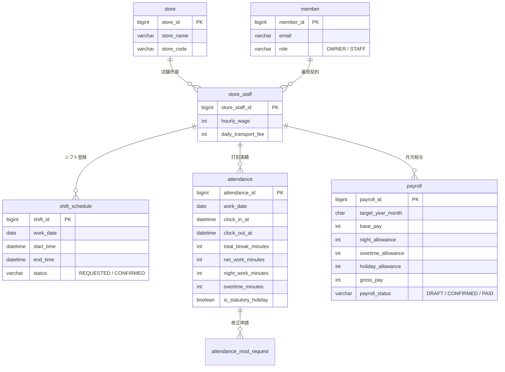
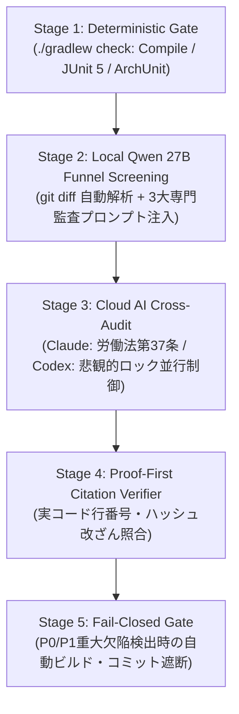

# KINTAI SaaS Refactored — 勤怠・給与管理リファクタリングおよび多層AI静的検証

[](https://github.com/KBG183/kintai-saas-refactored/actions/workflows/ci.yml)
[]()
[]()
[]()

> **日本の労働基準法第37条に準拠した、アルバイト勤怠・シフト・給与管理システム（リファクタリング成果物）**  
> 
> **Status: Phase 3 (欠陥是正・アーキテクチャ再設計・5層ハイブリッドAI自動検証パイプライン構築) 進行中**  
> Phase 2の多層AI逆工学監査によって検出された重大欠陥（労基法第37条の境界計算・悲観的ロック並行競合・マルチテナント境界）を根本是正し、ArchUnit決定論的ゲートおよび自社GPU（RTX 5070 Ti）連携の5層Fail-Closed品質検証基盤を配備しました。

---

## 🧭 3段階エンジニアリング連携 (3-Phase Engineering Journey)

> 📍 **現在の閲覧先: Phase 3 (kintai-saas-refactored)**  
> 実務バックエンド開発（Phase 1）と多層AI交差検証（Phase 2）を経て、検出された重大欠陥の是正と自動検証パイプライン統合を行う**最終リポジトリ（現在地）**です。



### 3段階プロジェクト連携概要

| フェーズ | リポジトリ / 状態 | 役割とエンジニアリングの目的 |
|:---:|---|---|
| **Phase 1**<br>KINTAI Core | [KBG183/kintai-management](https://github.com/KBG183/kintai-management)<br> | **初期バックエンド実装・As-Builtベースライン**<br>・Spring Boot / MyBatis による勤怠・シフト・給与ドメインの基本実装<br>・98件のJUnit結合テストによる機能担保と初期動作実績の確立 |
| **Phase 2**<br>SRS Triad Auditor | [KBG183/Hybrid-srs-triad-auditor](https://github.com/KBG183/Hybrid-srs-triad-auditor)<br> | **多層AI交差検証・SRS逆工学・マスターDiff分析**<br>・Codex, Claude, Qwen 27B, C#静的リンターによる多層監査網<br>・Phase 1コードからSRSを逆生成し、全17要件のギャップおよび境界条件の欠陥を摘発 |
| **Phase 3**<br>★ **現在地** | **[KBG183/kintai-saas-refactored](https://github.com/KBG183/kintai-saas-refactored)**<br>-brightgreen) | **欠陥是正・アーキテクチャ再設計・5層AI自動検証（本リポジトリ）**<br>・労基法37条 6段階法定割増エンジン再設計（`BigDecimal`・50銭端数処理厳格化）<br>・シフト確定時の悲観的ロック（`SELECT ... FOR UPDATE`）同時実行制御<br>・GitHub Actions CI + 自社GPU Qwen 27B + Cloud AI Fail-Closed 統合ゲート |

---

## 📌 プロジェクト概要 (Project Overview)

日本の外食・小売・サービス業界におけるアルバイト・パートタイム雇用では、掛け持ち勤務、深夜営業、複雑な労働基準法計算への対応が不可欠です。本システムは、現場で頻発する以下の課題を解決するために単独でアーキテクチャ設計および実装を行いました。

1. **労働基準法第37条の割増賃金計算エラーの撲滅**:
   - `深夜労働 (22:00 ~ 翌05:00, +25%)`
   - `時間外労働 (1日8時間超過, +25%)`
   - `深夜かつ時間外の重複労働 (+50%)`
   - これらを1分単位で自動判定し、`BigDecimal` を用いて丸め誤差のない厳密な給与計算を提供します。
2. **シフト希望・確定のリアルタイム調整とデータ整合性**:
   - 店長とスタッフ間でのシフト調整において、同時更新による不整合（Race Condition）を防ぐため、データベースレベルの**悲観的ロック (`SELECT ... FOR UPDATE`)** を適用。
3. **4打刻（出勤・休憩開始・休憩終了・退勤）による正確な実労働時間管理**:
   - 法定無給休憩時間を深夜帯と日中帯で厳密に分離し、過払い・未払いの発生を根本から防止。
4. **監査証跡（Audit Trail）を備えた打刻修正ワークフロー**:
   - 打刻漏れや修正の直接書き換えを禁止し、申請・承認履歴を完全記録。

---

## 🛠 技術スタック (Tech Stack)

| カテゴリ | 採用技術 | 選定理由・役割 |
| :--- | :--- | :--- |
| **Backend** | Java 17, Spring Boot 3.x / 4.x | 高い型安全性、堅牢なバックエンド構築 |
| **ORM / Mapper**| MyBatis 3.x | 複雑な労働時間集計クエリおよび排他ロック（FOR UPDATE）の制御最適化 |
| **Database** | MySQL 8.0 | トランザクション分離（InnoDB）、インデックス最適化 |
| **Security** | Spring Security 6 | セッションベースのロール制御（管理者: `OWNER`, 従業員: `STAFF`） |
| **Frontend** | Thymeleaf, Bootstrap 5.3 | サーバーサイドレンダリング、レスポンシブな店舗端末UI |
| **Calendar** | FullCalendar 6.x | 直感的な月間・週間シフトスケジュール視覚化 |
| **Office/Export**| Apache POI 5.2 | 税理士・社労士提出用の公式給与台帳（Excel）一括生成 |
| **Build Tool** | Gradle | 高速なマルチモジュール対応ビルド管理 |

---

## 🏛 アーキテクチャと主要機能 (Key Features & Architecture)

### 1. シフト管理エンジン (Shift Management Engine)
- **月間・週間カレンダー表示**: スタッフ別の希望シフト提出および店長による確定処理。
- **排他制御（悲観的ロック）**:
  - シフト確定・更新トランザクション時に `SELECT ... FOR UPDATE` を発行。
  - 複数管理者による同時変更や競合更新をトランザクションレベルで遮断。

### 2. 4打刻勤怠トラッキング (4-Punch Attendance Tracking)
- 出勤（Clock-In）、休憩開始（Break-Start）、休憩終了（Break-End）、退勤（Clock-Out）の4ステータス管理。
- 休憩時間帯を記録することで、**「深夜時間帯（22:00 ~ 05:00）に取得された休憩時間を深夜割増手当の対象から正確に控除」** するアルゴリズムを実装。

### 3. 改ざん防止・打刻修正ワークフロー (Audit Trail)
- 打刻修正申請テーブル（`attendance_mod_request`）による二重承認フロー。
- 過去データの直接書き換えを防止し、労働基準監督署の監査に対応可能な履歴追跡を担保。

### 4. 労働基準法第37条準拠 給与計算コア (Payroll Core Engine)

日本の労働法規に完全に準拠した給与ロジックをサービス層にカプセル化：

```
【計算ルール定義】
・基本給       = 所定労働時間 (8時間以内) × 基本時給
・時間外手当   = 実労働時間のうち1日8時間を超える時間 × 基本時給 × 1.25
・深夜手当     = 22:00 ~ 翌05:00 の実労働時間 × 基本時給 × 1.25
・深夜時間外   = 1日8時間を超え、かつ 22:00 ~ 翌05:00 に行われた労働 × 基本時給 × 1.50
・交通費       = MIN(出勤日数 × 日額交通費, 月額非課税限度額)
```

- **高精度金融演算**:
  - `double` / `float` 型の浮動小数点数誤差を排除するため、すべての通貨・手当計算に `BigDecimal` を採用。
  - 法定の端数処理（50銭未満切り捨て、50銭以上1円未満切り上げ）を厳密に制御。

### 5. 給与台帳 Excel 出力 (Apache POI Integration)
- 締め日にワンクリックで当月勤務実績および支給内訳を公式レイアウトの Excel シートとしてエクスポート。

---

## 📊 データベース設計 (Database Schema Overview)



---

## 🛡️ 品質保証および自動検証パイプライン (Quality Assurance & CI Gate)

本システムは、給与計算ミス（法令違反）や並行処理競合の発生を未然に防止するため、二重の自動検証アーキテクチャを導入しています。

### 1. 決定論的品質ゲート（GitHub Actions CI）
プルリクエストおよびコミットごとに、GitHub Actions 上で `./gradlew check` が自動実行されます。
- **ArchUnit によるアーキテクチャ不変条件の機械検証 (`KintaiArchitectureTest.java`)**:
  - 給与ドメインおよびサービス層における浮動小数点型（`double`, `float`）の使用を全面禁止（`BigDecimal` 必須）。
  - コントローラー層によるマッパー層への直接アクセス禁止（サービス層による業務カプセル化の強制）。
  - MyBatis マッパーのインターフェース規約強制。
- **MyBatis SQLインジェクション静的検知**:
  - 全マッパー XML を走査し、不安全な文字列置換 `${}` の混入を自動検知・ビルド遮断。
- **Zero-Korean 静的検証**:
  - 公開成果物・ソースコードへの不要な非日本語コメント・ログ混入を機械的に遮断。

### 2. 5層ハイブリッドAI交差検証システム (5-Tier Hybrid AI Pipeline)
自社GPU（NVIDIA RTX 5070 Ti）によるローカル LLM（Qwen 27B）とクラウド AI（Claude, OpenAI Codex）を連携させた多重監査パイプライン（`run_kintai_pipeline.ps1`）を運用しています。



- **ドメイン対応専門監査プロンプト (`tools/prompts/`)**:
  - `audit_labor_law_37.md`: 労働基準法第37条の6段階割増率および50銭端数処理の監査。
  - `audit_concurrency_lock.md`: 悲観的ロック（`SELECT ... FOR UPDATE`）およびデッドロック順序の監査。
  - `audit_idor_security.md`: Spring Security 6 RBAC認可およびテナント分離（IDOR防御）の監査。

---

## 🚀 クイックスタート (Local Setup)

### 前提条件
- **Java**: JDK 17 以上
- **Database**: MySQL 8.0 以上

### 1. リポジトリのクローン
```bash
git clone https://github.com/KBG183/kintai-saas-refactored.git
cd kintai-saas-refactored
```

### 2. データベース設定
`src/main/resources/application.yaml` に MySQL 接続情報を設定します（環境変数による上書きにも対応）。
```yaml
spring:
  datasource:
    url: jdbc:mysql://localhost:3306/kintai_db?useSSL=false&serverTimezone=Asia/Tokyo&characterEncoding=UTF-8
    username: ${DB_USER:root}
    password: ${DB_PASSWORD:1234}
```

### 3. ビルドおよび品質検証
```bash
# 決定論的静的検証および単体テストの実行 (ArchUnit, SQL安全検証含む)
./gradlew check

# アプリケーション起動
./gradlew bootRun
```

ブラウザから `http://localhost:8081` にアクセスします。

---

## 👨‍💻 技術的アピールポイント (Engineering Highlights)

- **実務に直結するドメインモデリング**:
  - 単なる一般的な CRUD アプリケーションではなく、日本特有の労務管理（掛け持ち勤務・労働基準法第37条）の法的要件を綿密に分析・定義。
- **データ整合性と堅牢性の担保**:
  - シフト希望更新時のデッドロック・競合更新を防止するトランザクション境界設計および悲観的ロックの採用。
- **金融水準の計算精度**:
  - 1円の過不足も許されない給与明細計算において、基幹系業務システムに求められる `BigDecimal` による端数処理基準を実装。
- **保守性と拡張性を意識したレイヤード設計**:
  - Controller - Service - Mapper (MyBatis) の責務を厳格に分離し、今後の給与計算式改定（法改正対応）にも Service 層の修正のみで追従可能な構造を担保。
