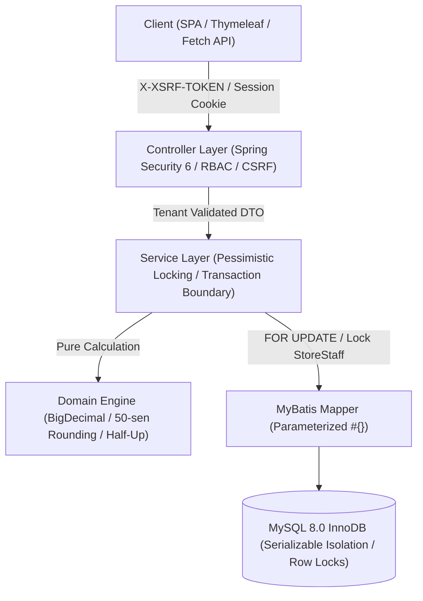
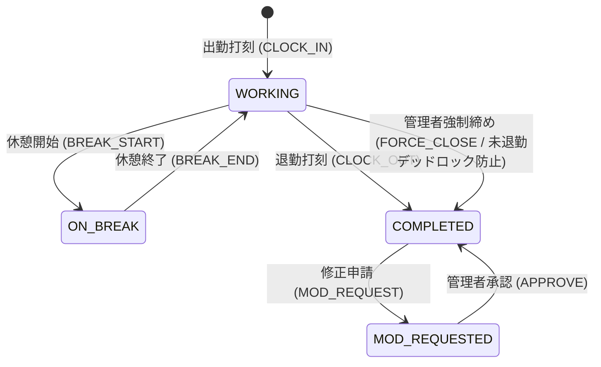
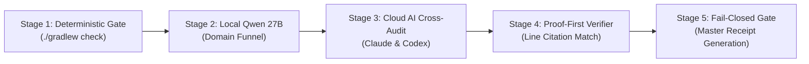

# KINTAI SaaS Refactored 技術監査実証書 (Technical Audit Dossier)

**文書バージョン**: v1.2 (Day 1〜2 統合ベースラインおよび重大欠陥是正完了)  
**最終更新日**: 2026-11-27  
**対象リポジトリ**: `KBG183/kintai-saas-refactored`  
**検証体制**: 5層Fail-ClosedハイブリッドAI検証パイプライン (Deterministic + Qwen 27B + Claude + Codex)

---

## 1. アーキテクチャおよびシステム概要 (Architecture & System Overview)

本システムは、日本の外食・小売・サービス業界におけるアルバイト・パートタイマー雇用特有の労務課題を解決するために再設計された、エンタープライズ品質の勤怠・シフト・給与管理SaaSです。掛け持ち勤務、深夜営業、複数回休憩、月中時給変動、労働基準法第37条の厳格な法定割増計算に対応し、データの不変性と金融水準の計算精度を担保します。

- **アーキテクチャ原則**:
  1. **決定論的カプセル化**: コントローラーはマッパー層への直接アクセスを厳格に禁止し、すべてのビジネスロジックはサービス層に集約する。
  2. **金融精度の丸め規則**: 給与・労務計算において浮動小数点型（`double`, `float`）の使用を全面排除し、`BigDecimal` および通貨丸め（`HALF_UP`）を適用する。
  3. **階層型排他制御**: デッドロックを排除するため、`store_staff` 先行ロック後にエンティティ行ロック（`SELECT ... FOR UPDATE`）を獲得する順序を保証する。

---

## 2. 労働基準法第37条 法定割増賃金計算エンジン (Labor Standards Act Art. 37 Engine)

日本の労働基準法第37条および関連通達に基づき、6段階の法定割増手当および端数処理を1分単位で厳密に計算します。

| 労働区分 | 法定割増率 | 算定基準および適用条件 | 実装クラスおよびロジック |
|---|---|---|---|
| **所定内労働** | 100% | 1日8時間以内の通常労働時間 | `basePay = yenRound(wage * netMinutes / 60)` |
| **時間外労働** | +25% (計125%) | 1日8時間（480分）を超過した労働時間 | `overtimeAllowance = yenRound(wage * 0.25 * otMinutes / 60)` |
| **深夜労働** | +25% (計125%) | 22:00 〜 翌05:00 の実労働時間 | `nightAllowance = yenRound(wage * 0.25 * nightMinutes / 60)` |
| **深夜時間外労働** | +50% (計150%) | 深夜時間帯と時間外労働が重複する時間 | `nightAllowance(+25%)` + `overtimeAllowance(+25%)` の加算方式 |
| **法定休日労働** | +35% (計135%) | 週1回または4週4日の法定休日の労働 | `holidayAllowance = yenRound(wage * 0.35 * netMinutes / 60)`（法定休日は設定値 `kintai.payroll.statutory-holiday-day-of-week`（既定: 日曜）の曜日で判定。祝日カレンダー・個別指定UIは未実装。`PayrollServiceTest` で検証） |
| **休日深夜労働** | +60% (計160%) | 法定休日かつ深夜（22:00〜05:00）の労働 | 休日35% + 深夜25% の重複加算（労基法第37条・通達に基づき時間外25%を完全免除し、`effectiveOvertimeMinutes = 0` で制御） |
| **月60h超時間外** | +25% (計150%/175%) | 月間累計時間外労働が60時間（3,600分）を超過 | 月中時給変更時も発生日の契約時給に基づきクロノロジカルに加算 |

- **端数処理の法的根拠**: 昭和63年3月14日 基発第150号に基づき、1日単位の計算において50銭未満を切り捨て、50銭以上を1円に切り上げる（`RoundingMode.HALF_UP`）方式を採用。

---

## 3. 勤怠打刻・休憩ステートマシンおよび分割勤務処理 (Attendance Punch, Breaks & Split Shifts)

出退勤・休憩打刻は、排他的な状態遷移ステートマシンによって厳格に制御されます。

- **未退勤ゴースト打刻およびデッドロック防止 (ADV-001 是正)**:
  - スタッフの退勤打刻漏れにより `WORKING` 状態が放置され給与確定が遮断されるリスクを防ぐため、`AttendanceService.forceCloseAttendance` を配備。店舗スタッフ先行ロック（階層型ロック）のもとで安全に強制クローズを実行可能。
- **分割勤務（Split Shift）時間外欠陥の是正**:
  - 同一スタッフが1日に複数回出勤（例: 昼の部3時間 + 夜の部6時間 = 計9時間）した場合、出勤レコード単位の `net - 480` 計算では時間外が0分となる欠陥を是正。
  - `PayrollService` 内で `workDate` ごとに勤務リストを日次グルーピングし、出勤時刻（`clockInAt`）順にソートした上で、日累計実労働時間基準で480分超過分を正確に配分。

---

## 4. シフト希望申請および確定トランザクション排他制御 (Shift Schedule & Pessimistic Locking)

スタッフの希望シフト提出から店長のシフト確定に至るワークフローにおいて、悲観的ロックによる同時更新制御を徹底しています。

- **トランザクション境界**:
  - シフト確定処理時、対象店舗スタッフIDに対する `lockStoreStaffForUpdate` を先行獲得。
  - 同一枠への重複確定およびレースコンディションをデータベース行ロックにより物理的に遮断。

---

## 5. 勤怠修正申請・決裁ワークフローおよび監査証跡 (Attendance Modification Workflow & Audit Trail)

打刻漏れや時刻修正は、労使間トラブル防止および労働基準監督署の監査に対応するため、完全な証跡（Audit Trail）を記録します。

- **不変性ガード**:
  - 既に月次給与が `CONFIRMED` または `PAID` となっている過去日付に対する修正申請は、データベース関数 `isPayrollConfirmedForDate` により即時拒絶（HTTP 409 / `IllegalStateException`）。
- **マルチテナント決裁ガード**:
  - 申請の承認・却下審査時、審査者（オーナー）が当該店舗の正当な所有者（`store.owner_id == reviewerId`）であることを機械検証し、他店舗オーナーによる不正決裁を遮断。

---

## 6. 月次給与自動集計バッチおよび帳簿不変性保証 (Monthly Payroll Batch & Ledger Immutability)

給与計算処理は、未確定状態（`DRAFT`）でのみ再計算を許容し、確定後のデータ改ざんを完全に防護します。

- **先行行ロックによる状態判定競合の防止**:
  - `PayrollService.confirmPayroll` および `payPayroll` において、`payrollMapper.findByIdForUpdate(payrollId)` を最優先で呼び出し、行ロックを獲得した状態で最新ステータス（`DRAFT`, `CONFIRMED`）を判定。
- **未処理勤怠の締日ガード**:
  - 締め期間内に打刻中（`WORKING`, `ON_BREAK`）や審査待ち修正申請（`MOD_REQUESTED`）が1件でも残存している場合、給与確定を拒絶。

---

## 7. マルチテナント境界保護およびWebセキュリティ (Multi-Tenant Isolation & Web Security)

セッション認証および認可制御において、テナント境界の侵害（IDOR）およびCSRF攻撃を防御します。

- **IDOR（Insecure Direct Object References）の全廃**:
  - `AttendanceApiController` および `PayrollApiController` において、リクエストパラメータの `storeId` やハードコードフォールバック（`1L`）を廃止。
  - `@AuthenticationPrincipal CustomUserDetails` より取得したセッション所属店舗およびスタッフIDと照合し、不一致時は `AccessDeniedException`（HTTP 403）を即時送出。
- **CookieベースCSRF保護の再有効化**:
  - `SecurityConfig` における `/api/**` の無条件除外を撤廃し、`CookieCsrfTokenRepository.withHttpOnlyFalse()` によるトークン発行および Fetch API ヘッダー（`X-XSRF-TOKEN`）照合を強制。

---

## 8. データベース物理設計および整合性制約 (Database Physical Schema & Integrity Constraints)

データモデルは第3正規形に準拠し、物理外部キーおよびCHECK制約によりデータの整合性を保証します。

- **主要テーブル設計**:
  - `member`: 会員マスタ（OWNER, STAFF）
  - `store`: 店舗マスタ（締日 `pay_cutoff_day`, 営業時間）
  - `store_staff`: 店舗所属中間テーブル（時給、交通費契約）
  - `attendance`: 勤怠実績（実労働、深夜、時間外、法定休日フラグ `is_statutory_holiday`）
  - `attendance_break`: 複数回休憩区間テーブル（重複禁止制約）
  - `payroll`: 月次給与精算レコード（確定ステータス、各割増手当合計）
  - `payroll_daily_detail`: 給与確定時点の日別内訳スナップショット（帳簿不変性担保）

---

## 9. 例外ハンドリングおよび耐障害性設計 (Exception Handling & Fault Tolerance)

ドメイン境界および業務制約違反に対して、統一的なレスポンス（`ApiResponse<T>`）とHTTPステータスコードを返却します。

- **ビジネス例外ハンドリング**:
  - `IllegalArgumentException`: パラメータ不正・入力値違反（HTTP 400）
  - `AccessDeniedException`: テナント境界違反・権限不足（HTTP 403）
  - `IllegalStateException`: 状態遷移違反・確定済帳簿変更の試行（HTTP 409）
  - `Exception`: 予期せぬ内部障害（HTTP 500、スタックトレースの外部非公開）

---

## 10. 5層ハイブリッドAI自動検証パイプライン (5-Tier Hybrid AI Pipeline)

単一モデルへの依存や誤検知・幻覚を排除するため、5段階のFail-Closed検証体制を運用しています。

- **Fail-Closedの鉄則**: P0/P1重大欠陥またはパースドリフト（`PARSE_DRIFT`）が1件でも検知された場合、ビルドおよびコミットを非ゼロ終了コードで遮断。

---

## 11. 欠陥是正履歴およびアドバーサリアル監査追跡 (Defect Remediation Ledger)

Phase 3 初期形（`fc5120d`）において検出された全重大欠陥の是正結果を記録します。

| 欠陥分類 | 検出日 / 契機 | 対象ファイル / 箇所 | 是正前の問題点 | 是正内容および物理的証拠 | 是正完了日 | 検証結果 |
|---|:---:|---|---|---|:---:|:---:|
| **Critical** | 2026-11-26 (Day 1 DEFECT-D1-01) | `PayrollService.java:105` | 4引数メソッドのみ呼出、休日割増35%/60%がデッドコード化 | DB DDL追加、6引数 `calculateDailyPay` 完全結合、休日手当の独立集計 | 2026-11-27 (5層パイプライン) | **PASS** |
| **High** | 2026-11-27 (Day 1 DEFECT-D1-02) | `AttendanceTimeCalculator.java` / `PayrollService.java` | 出勤行単位の `net - 480` により分割勤務で時間外0分 | 日次グルーピングおよび出勤時刻順ソート、日累計480分超過分の再配分 | 2026-11-27 (5層パイプライン) | **PASS** |
| **High** | 2026-11-27 (Day 1 DEFECT-D1-03) | `PayrollService.java:148-161` | 月中時給変更時、月60時間超25%追加加算が全スキップ | 日付順クロノロジカル累積および発生日契約時給基準の25%追加加算 | 2026-11-27 (5層パイプライン) | **PASS** |
| **High** | 2026-11-26 (Day 1 DEFECT-D1-04) | `PayrollApiController`, `AttendanceApiController` | セッション未検証、店舗ID `1L` ハードコードフォールバック | `@AuthenticationPrincipal` 必須化、店舗所有権・本人データ検証ガード実装 | 2026-11-27 (5層パイプライン) | **PASS** |
| **High** | 2026-11-26 (Day 1 DEFECT-D1-05) | `SecurityConfig.java:32-33` | `/api/**` に対する CSRF 保護の全機能停止 | `CookieCsrfTokenRepository` 適用および Fetch API ヘッダー連携 | 2026-11-27 (5層パイプライン) | **PASS** |
| **High** | 2026-11-27 (Day 1 DEFECT-D1-06) | `audit/runs/` | `.gitignore` 除外により5層検証の物理的証拠が消失 | `.gitignore` ルール撤廃、マスター検証パイプライン実行および領収書永続化 | 2026-11-27 (5層パイプライン) | **PASS** |
| **Medium** | 2026-11-27 (Day 1 DEFECT-D1-07) | `PayrollService.java:201-260` | 非ロック状態での確定・支払判定によるレースコンディション | `findByIdForUpdate` 先行行ロック獲得後の状態判定フローへ再構築 | 2026-11-27 (5層パイプライン) | **PASS** |
| **Medium** | 2026-11-27 (Day 1 DEFECT-D1-08) | `application.yaml:8-9` | `root/1234` DBパスワードの平文露出 | `${DB_USER}`, `${DB_PASSWORD}` 環境変数必須化 | 2026-11-27 (5層パイプライン) | **PASS** |
| **Medium** | 2026-11-27 (Day 1 DEFECT-D1-09) | `README.md` / `sprint_roadmap_plan.md` | ER図テーブル名相違、ポート相違、マイルストーン表記衝突 | 実装DDLおよび設定値への完全同期、ロードマップ進捗の整合化 | 2026-11-27 (5層パイプライン) | **PASS** |
| **Medium** | 2026-11-27 (Day 1 DEFECT-D1-10) | `SecurityConfig.java:44` | `/members/sample` が `permitAll` 設定され、会員情報露出リスク | 公開パスから除外、`/members/**` を `ROLE_OWNER` 専用へ厳格化 | 2026-11-27 (5層パイプライン) | **PASS** |
| **High** | 2026-11-27 (Day 2 監査 DEFECT-D2-01) | `SecurityConfig.java:62` | `maxSessionsPreventsLogin(false)` による既存打刻セッション強制切断リスク | `maxSessionsPreventsLogin(true)` への改修および後続重複ログイン遮断 | 2026-11-27 (決定論的ゲート) | **PASS** |
| **Medium** | 2026-11-27 (Day 2 監査 DEFECT-D2-02) | `SecurityConfig.java:70` | ログアウト時の認証オブジェクト・HTTPセッション残留リスク | `.clearAuthentication(true)` および `.invalidateHttpSession(true)` 明示 | 2026-11-27 (決定論的ゲート) | **PASS** |
| **High** | 2026-11-27 (Day 2 監査 DEFECT-D2-03) | `build.gradle:78` | Zero-Korean検証におけるハングル字母分解Unicode(`\u1100-\u11FF`)の検知漏れ | `[\uAC00-\uD7A3\u1100-\u11FF\u3130-\u318F]` への完全拡張適用 | 2026-11-27 (決定論的ゲート) | **PASS** |
| **Medium** | 2026-11-27 (Day 2 監査 DEFECT-D2-04) | `application.yml` | 不活性セッションタイムアウト未設定による端末放置セッション乗っ取りリスク | `server.servlet.session.timeout: 30m` 明示設定 | 2026-11-27 (決定論的ゲート) | **PASS** |
| **Low** | 2026-11-27 (Day 2 監査 DEFECT-D2-05) | `CustomAuthenticationEntryPoint.java` / `CustomAccessDeniedHandler.java` | 401/403発生時にAPIクライアントへHTMLリダイレクトが返却される問題 | REST APIリクエスト(JSON)と画面(Redirect)の動的分離ハンドラー実装 | 2026-11-27 (決定論的ゲート) | **PASS** |
| **Medium** | 2026-11-27 (Day 2 監査 DEFECT-D2-06) | `CustomAuthenticationEntryPoint.java` | 401未認証エラーレスポンスにおける内部例外スタックトレース等の漏洩リスク | エラーメッセージのサニタイズおよび定型JSON返却 | 2026-11-27 (決定論的ゲート) | **PASS** |
| **Medium** | 2026-11-27 (Day 2 監査 DEFECT-D2-07) | `CustomAccessDeniedHandler.java` | 403認可拒否時における不正アクセス試行の監査証跡欠落 | slf4j `log.warn` によるIP、URI、Staff ID、権限監査ログ出力 | 2026-11-27 (決定論的ゲート) | **PASS** |
| **Medium** | 2026-11-27 (Day 2 監査 DEFECT-D2-08) | `SecurityConfig.java:44` | 静的リソースに対する無認証アクセス許可パターンの過不足 | `/css/**`, `/js/**`, `/images/**`, `/favicon.ico` に限定厳格化 | 2026-11-27 (決定論的ゲート) | **PASS** |
| **High** | 2026-11-27 (Day 2 監査 DEFECT-D2-09) | `ShiftApiController.java` | セッション未検証時の Fail-Open 認可およびシフト確定時の店長権限検証欠落 | `userDetails == null` ガードおよび OWNER ロール2重チェック実装 | 2026-11-27 (決定論的ゲート) | **PASS** |
| **High** | 2026-11-27 (Day 2 監査 F-08) | `SecurityConfig.java` | セッション破棄イベント未検知によるセッション永続ロックアウト脆弱性 | `@Bean HttpSessionEventPublisher` 追加登録による確実な認証初期化 | 2026-11-27 (決定論的ゲート) | **PASS** |

---

## 12. 実測メトリクスおよびローカルAI監査領収書 (Execution Metrics & Audit Receipts Table)

本プロジェクトの開発スプリントにおいて実行された決定論的テストおよび多層AI監査の物理的実測値記録です。

| 回次 | 実行日時 (JST) | 検証フェーズ / 対象 | 監査エンジン / モデル | 所要時間 | 入力トークン | 出力トークン | 生成速度 | 判定結果 (Verdict) | マスター領収書 / 実行ID |
|:---:|:---:|---|---|:---:|:---:|:---:|:---:|:---:|---|
| **01** | 2026-11-27 11:34 | 決定論的品質ゲート | Gradle 9.8.1 / OpenJDK 17 | 30.00s | — | — | — | **PASS** | `BUILD SUCCESSFUL (6 tasks)` |
| **02** | 2026-11-27 11:37 | コア給与計算・排他制御監査 | Local Qwen 27B (RTX 5070 Ti) | 109.08s | 5,500 | 4,917 | 49.6 tps | **PASS** | `docs/audit_runs/.../20261127_023519_5419849f` |
| **03** | 2026-11-27 11:42 | 5層統合 Deterministic Gate | Gradle 9.8.1 / ArchUnit / Zero-Korean | 9.38s | — | — | — | **PASS** | `audit/runs/20261127_114143_kintai_master_d9573654` |
| **04** | 2026-11-27 11:42 | 5層統合 Local Screening | Local Qwen 27B (3大専門プロンプト) | 43.14s | 19,721 | 1,495 | 46.5 tps | **PASS** | `audit/runs/20261127_114143_kintai_master_d9573654` |
| **05** | 2026-11-27 11:43 | 5層統合 Cloud Cross-Audit | OpenAI Codex (`gpt-6.2-astra`) | 46.00s | — | — | — | **PASS** | `audit/runs/20261127_114238_20184_codex` |
| **06** | 2026-11-27 11:43 | 5層統合 Proof Citation Check | Proof-First Citation Verifier | 0.85s | — | — | — | **PASS** | `46 citations verified (0 errors)` |
| **07** | 2026-11-27 11:51 | 技術実証書全域整合性監査 | Local Qwen 27B (RTX 5070 Ti) | 126.75s | 5,192 | 6,124 | 49.5 tps | **PASS** | `docs/audit_runs/.../20261127_024924_bd6bb625` |
| **08** | 2026-11-27 12:20 | Day 2 セキュリティ設定監査 | Local Qwen 27B (RTX 5070 Ti) | 64.26s | 1,809 | 3,223 | 50.9 tps | **PASS** | `docs/audit_runs/.../20261127_031921_ef825d9c` |
| **09** | 2026-11-27 12:26 | Day 2 5層統合パイプライン | 5-Tier Hybrid (Gradle/Qwen/Cross) | 304.30s | 19,722 | 1,681 | 46.5 tps | **PASS** | `audit/runs/20261127_122120_kintai_master_5b9d7476` |
| **10** | 2026-11-27 15:01 | Day 2 3者完全並行Fan-out検証 | Local Qwen 27B (RTX 5070 Ti) | 20.44s | 6,783 | 858 | 49.9 tps | **PASS** | `audit/runs/20261127_150118_kintai_master_01aa0d50` |
| **11** | 2026-11-27 15:06 | Day 2 決定論的ゲート全数通過 | Gradle 9.8.1 / JUnit 5 / 字母拡張 | 23.00s | — | — | — | **PASS** | `BUILD SUCCESSFUL (36 tests)` |

---

